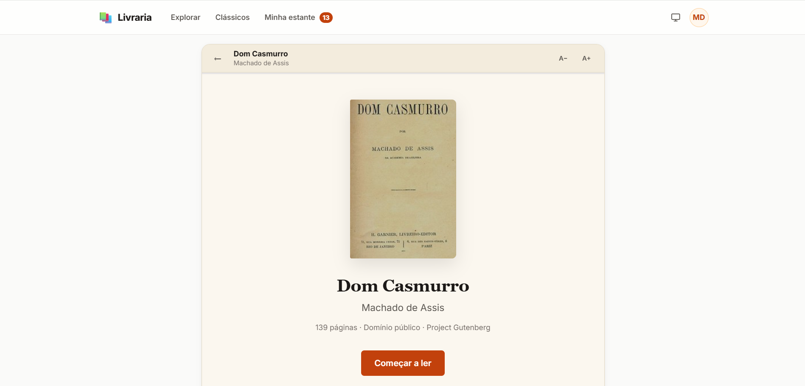
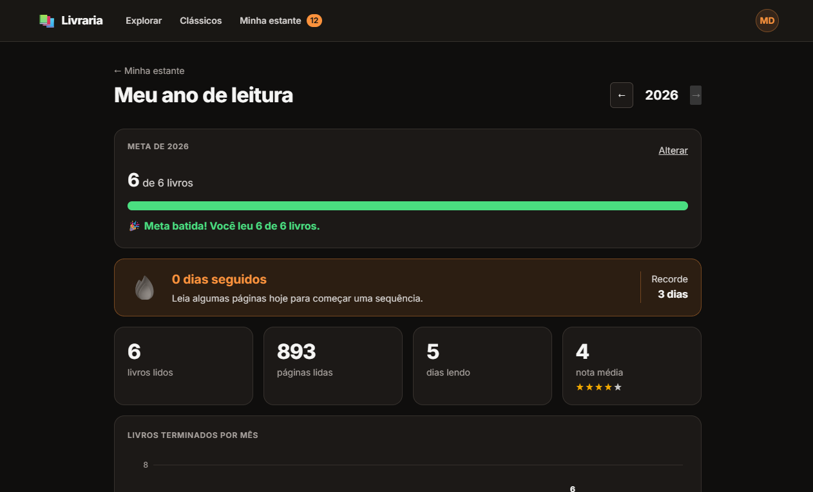

# 📚 Livraria

Um gerenciador de leituras: encontre livros, organize sua estante, acompanhe o progresso e leia clássicos em domínio público direto no site.

> 🔗 **Site no ar:** [livraria-virtual.netlify.app](https://livraria-virtual.netlify.app/)


## Funcionalidades

- **Busca de livros** na API do Google Books, com sugestões, capas em alta resolução (Open Library) e prévia embutida do Google.
- **Conta de usuário** com cadastro e login (Supabase Auth).
- **Estante pessoal** com as listas *Lendo*, *Quero ler*, *Lidos* e *Favoritos*.
- **Acompanhamento de leitura:** página atual, progresso, nota de 1 a 5 estrelas e resenha.
- **Clássicos grátis:** mais de 600 livros em português do Project Gutenberg, com um **leitor** próprio que salva o progresso sozinho.
- **Meu ano de leitura:** estatísticas, gráfico de livros por mês, meta anual com ritmo e sequência de dias lendo 🔥.
- **Modo escuro**, que pode seguir o sistema ou ser escolhido manualmente.

| Página do livro | Leitor | Estatísticas (modo escuro) |
|---|---|---|
|  |  |  |

## Tecnologias

- **Front-end:** React, Vite, React Router, Axios, Recharts e React Toastify
- **Back-end:** Supabase (Postgres com Row Level Security, Auth e Edge Functions)
- **APIs:** Google Books, Open Library e Gutendex (Project Gutenberg)
- **Estilo:** CSS puro com design tokens, sem frameworks, e as fontes Inter e Literata

## Como rodar localmente

**Pré-requisitos:** Node.js (versão LTS), uma conta no [Supabase](https://supabase.com) e uma chave da [Books API](https://console.cloud.google.com/apis/library/books.googleapis.com) do Google.

1. Clone o repositório e instale as dependências:
   ```bash
   git clone https://github.com/Mateusinhodev/livraria.git
   cd livraria
   npm install
   ```

2. Crie o arquivo `.env` a partir do modelo e preencha com os seus valores:
   ```bash
   cp .env.example .env
   ```

3. No **SQL Editor** do Supabase, rode os scripts da pasta `supabase/`, nesta ordem:
   `schema.sql` → `historico.sql` → `metas.sql` → `dias_leitura.sql`

4. Publique a Edge Function `texto-livro` (pasta `supabase/functions/`), que entrega o texto dos clássicos ao leitor.

5. Inicie o servidor de desenvolvimento:
   ```bash
   npm run dev
   ```
   O site abre em `http://localhost:3000`.

## Estrutura do projeto

```
src/
├── components/   # Peças reutilizáveis (CardLivro, PainelLeitura, MetaAnual...)
├── contexts/     # Estado global: autenticação e estante
├── hooks/        # Hooks próprios (useTema)
├── lib/          # Clientes de serviços externos (Supabase, visualizador do Google)
├── pages/        # Uma pasta por tela
├── services/     # Comunicação com APIs e banco de dados
├── styles/       # Estilos globais: botões, cartões e esqueletos
└── utils/        # Funções auxiliares
supabase/         # Scripts SQL e Edge Function
```

## Decisões e aprendizados

- **Segurança no banco:** cada tabela tem **Row Level Security**, e cada pessoa só lê e altera os próprios dados, mesmo chamando a API diretamente.
- **Diário de leitura automático:** um *trigger* no Postgres registra as páginas lidas a cada atualização de progresso, sem depender do front-end.
- **Interface otimista:** a estante atualiza na hora e desfaz a mudança se o banco recusar.
- **Design tokens em duas camadas** (paleta e papéis): o modo escuro foi feito redefinindo só os papéis, sem tocar nos componentes.
- **Resiliência:** novas tentativas automáticas com espera exponencial para erros temporários da API e cache das buscas.
- **Acessibilidade:** contraste conferido (WCAG AA), navegação por teclado, foco visível e rótulos para leitores de tela.

## Autor

Feito por **Mateus** · [GitHub](https://github.com/Mateusinhodev)